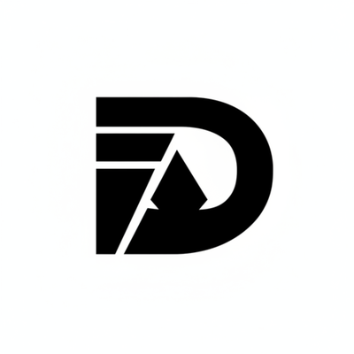

# Draftless MCP server



**Draftless** is an AI creative studio your agent can drive. Generate images, video (Seedance 2.5, Veo, Kling and more), voiceover, music and 3D; edit, upscale, reframe and composite; plan and produce ads, UGC and launch films; and publish to Instagram, Facebook and TikTok.

This is a **hosted (remote) MCP server**. There is nothing to install or run locally.

- **Server URL:** `https://mcp.draftless.dev/mcp` (Streamable HTTP)
- **Auth:** OAuth 2.1 with dynamic client registration — your client opens a Draftless sign-in the first time you connect.
- **Website:** https://draftless.dev · **Connect guide:** https://draftless.dev/mcp

## Connect

### Claude (claude.ai / Claude Desktop)
Settings → Connectors → **Add custom connector** → URL `https://mcp.draftless.dev/mcp` → sign in.

### Claude Code
```bash
claude mcp add --transport http draftless https://mcp.draftless.dev/mcp
```
Then run `/mcp` and authenticate.

### Cursor / Windsurf / VS Code / Cline (any client with remote MCP support)
```json
{
  "mcpServers": {
    "draftless": { "url": "https://mcp.draftless.dev/mcp" }
  }
}
```

### Clients without remote/OAuth support
```json
{
  "mcpServers": {
    "draftless": { "command": "npx", "args": ["-y", "mcp-remote", "https://mcp.draftless.dev/mcp"] }
  }
}
```

## What it can do
Domain tools, each taking `{ action, input }`:

| Tool | Examples |
|---|---|
| `discover` | list models and capabilities, recommend a pipeline, `describe_action` (schema, example and cost of any action) |
| `plan` | costed plans for ads, UGC, storyboards, product shoots |
| `generate` | images, video, audio, 3D, batches, story/SaaS launch films |
| `jobs` | poll async jobs (long-poll up to 12 at once) |
| `assets` | asset library, uploads, imports |
| `image_edit` / `video_edit` | upscale, background removal, reframe, relight, inpaint, subtitles, extend… |
| `characters` | consistent characters, avatars, lipsync |
| `social` | publish to Instagram, Facebook, TikTok |

## Credits and safety
Draftless is pay-per-use. **Every paid action returns a free price preview first and only spends after you confirm.** Results are saved to your Draftless asset library with a link to recreate them. New accounts get starter credits.

## Support
andrea.lotito@draftless.dev · [Privacy](https://draftless.dev/privacy) · [Terms](https://draftless.dev/terms)
